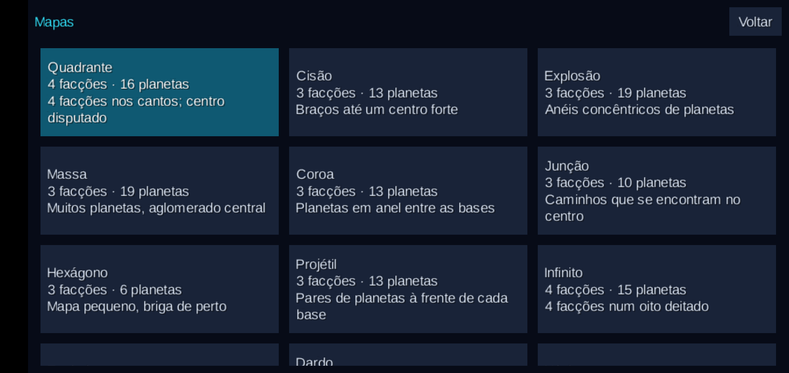
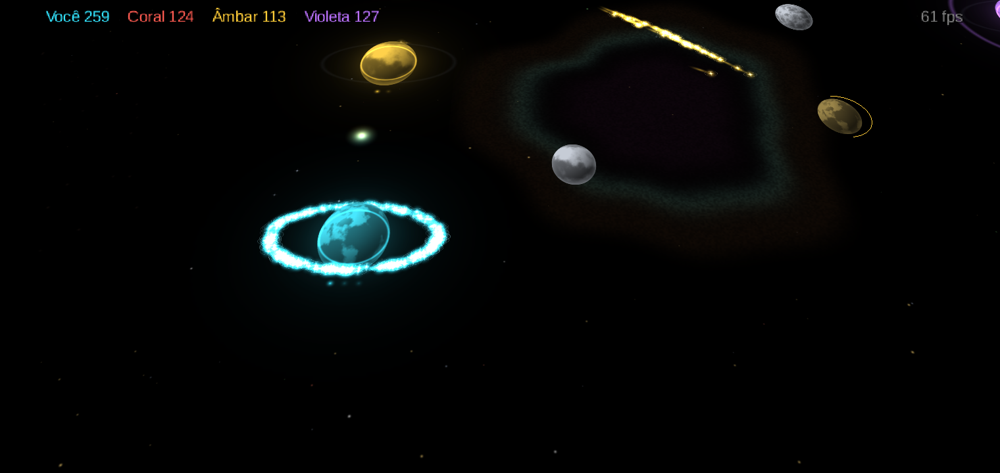

# Órbita

**Jogo Android de estratégia espacial em tempo real: enxames de luz disputando planetas.**
Kotlin + libGDX, simulação determinística, bots com IA própria e 13 mapas. Feito num único dia de trabalho,
em par com um agente de IA (Claude Code).


> **Sobre a origem:** o projeto começou como um teste do **REA** (ferramenta de engenharia reversa via MCP)
> usando o jogo *Auralux: Constellations* como alvo de estudo. O objetivo era validar o REA num caso real.
> Do estudo saíram só as regras gerais do gênero. Todo o código, a arte (procedural, gerada em código),
> os mapas e o nome são originais: nenhum código, asset ou mapa do jogo de referência está neste repositório.

---

## O jogo

Cada planeta seu produz unidades de luz. Você seleciona enxames com o dedo e os envia para capturar planetas
neutros, evoluir os seus ou destruir os dos inimigos. Quando enxames de cores diferentes se encontram, eles se
anulam um a um. Vence quem sobrar.

- **Jogador contra 3 bots**, cada um com uma personalidade: Expansionista, Agressivo e Construtor.
- **13 mapas** simétricos (Quadrante, Cisão, Espiral, Infinito…).
- **Câmera 3D** que inclina conforme o zoom, com órbitas em perspectiva.
- **Menu de ajustes** com ~60 parâmetros de simulação, IA, visual e câmera, todos editáveis no próprio jogo.
- **60 fps** num Galaxy A10 (aparelho de entrada, ARMv7), com milhares de unidades na tela.

| Mapas | Perspectiva | Ajustes da IA |
|---|---|---|
|  |  |  |

## Números

| | |
|---|---|
| Código | ~4.700 linhas de Kotlin em 6 módulos |
| Testes | 17 testes automatizados (regras, determinismo, IA, mapas) |
| Determinismo | Hash do estado **idêntico** entre JVM desktop e Android (ARM) |
| Desempenho da simulação | 2.016 unidades: 0,02 ms/tick no desktop, ~1,9 ms/tick no Galaxy A10 |
| Arena headless | 480 partidas bot × bot (120 h de jogo) em 76 s, ~5.700× o tempo real |
| Assets | Nenhum arquivo de imagem ou som: tudo é gerado em código |

## Como rodar

Requisitos: JDK 17 e Android SDK (para o APK).

```bash
./gradlew :desktop:run                       # joga no desktop
./gradlew :android:installDebug              # instala no aparelho conectado
./gradlew :sim:test :ai:test                 # testes
./gradlew :tools:arena:run --args="480 15"   # 480 partidas bot × bot de até 15 min
./gradlew :desktop:probe                     # hash de determinismo + desempenho
```

**Controles:** arrastar desenha o laço de seleção; tocar num planeta seu seleciona as unidades dele; com seleção
ativa, tocar num planeta ou ponto envia o enxame; dois dedos fazem pan e zoom. No desktop: botão direito faz pan,
a roda faz zoom, **D** mostra as decisões da IA e **Esc** abre os ajustes.

## Arquitetura

```text
game ──► ai ──► sim          sim e ai: Kotlin/JVM puro (sem libGDX, sem Android)
 ▲                            game: libGDX + KTX (render, input, HUD, ajustes)
 ├── android/  desktop/       launchers
 └── tools/arena/             partidas headless bot × bot
```

A separação é o ponto central: como `sim` e `ai` não conhecem a tela, dá para testar as regras com JUnit e rodar
milhares de partidas mais rápido que o tempo real.

## Documentação

1. [O processo](docs/01-processo.md): como o projeto foi feito, do estudo ao APK assinado, fase a fase.
2. [Arquitetura e simulação](docs/02-arquitetura.md): tick fixo, dados em SoA, grade espacial, determinismo e render.
3. [IA dos bots](docs/03-ia-dos-bots.md): utility AI, personalidades, arena e próximos passos.
4. [Testes e desempenho](docs/04-testes-e-desempenho.md): o que é testado e as medições no aparelho.
5. [Evolução visual](docs/05-evolucao-visual.md): do primeiro protótipo à câmera em perspectiva, com capturas.

## Stack

Kotlin 2.4 · libGDX 1.13.1 + KTX · Gradle 8.13 · AGP 8.13 · JDK 17 · Android 5.0+ (minSdk 21, target 36).

## Licença

Código publicado para estudo e portfólio. Todos os direitos reservados ao autor, Ronaldo Mafra.
Auralux é marca de seus respectivos donos. Este projeto não tem relação com eles.
