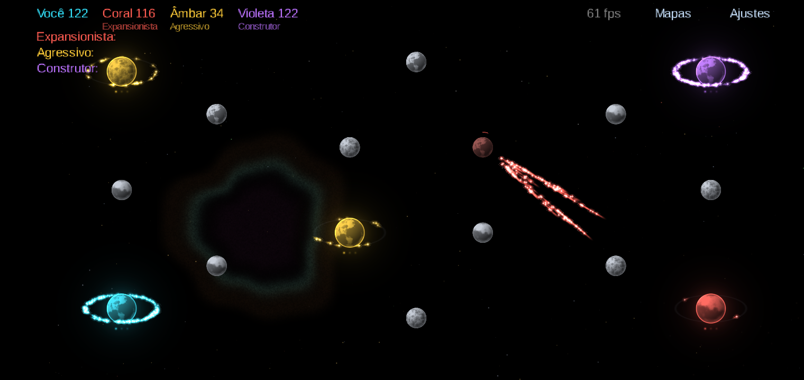
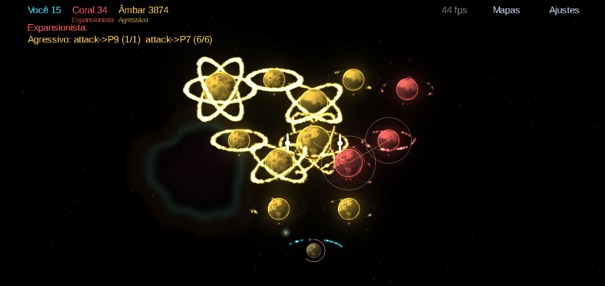
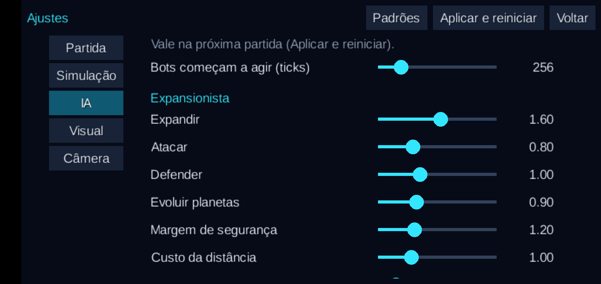

# 3. IA dos bots

*Overlay de debug: linhas de cada fonte até o alvo e o texto `tipo->planeta (enviado/necessário)`.*

*Fim de partida: o Agressivo (âmbar) com ~3.900 unidades decide `attack->P9 (1/1)` e `attack->P7 (6/6)`. Com essa quantidade de unidades e o overlay ligado, o A10 fica em ~44 fps.*

## Princípios

- **Mesma API do jogador.** Os bots só emitem `SendUnits`, exatamente como o toque do jogador. Não há bônus
  escondido nem acesso a informação invisível.
- **Determinística.** Mesma seed, mesmas decisões. Isso permite reproduzir uma partida e medir mudanças.
- **Barata.** Cada bot decide a cada ~1–1,5 s, escalonado, e não pesa no Galaxy A10.
- **Feita para evoluir:** pesos expostos, overlay de depuração e uma arena para medir.

## Como decide (utility AI)

`Observation` resume o estado por planeta: o power de cada facção em órbita e a caminho. Com isso, o
`UtilityBot`:

1. monta candidatos: **expandir** (neutro), **atacar** (inimigo), **defender** ou **reparar** (próprio
   ameaçado ou danificado) e **evoluir** (próprio);
2. calcula a **necessidade** de cada um (power para concluir, incluindo as ameaças) × margem de segurança;
3. escolhe as **fontes** mais próximas, preservando a defesa dos planetas ameaçados;
4. pontua: `valor × eficiência ÷ (1 + custo da distância) × ruído`;
5. executa os melhores, até um limite de ordens por decisão.

## Personalidades

| | Expandir | Atacar | Defender | Evoluir | Margem | Foco no líder | Comportamento |
|---|---|---|---|---|---|---|---|
| Expansionista | **1,6** | 0,8 | 1,0 | 0,9 | 1,2 | 0,2 | Pega neutros cedo; o que mais vence na arena |
| Agressivo | 1,0 | **1,6** | 0,8 | 0,6 | 1,0 | **0,6** | Foca o líder; quando não vence, raramente sobra na liderança |
| Construtor | 1,0 | 0,8 | **1,4** | **1,6** | **1,4** | 0,3 | Evolui e defende; lidera, mas raramente fecha |

Todos os pesos podem ser alterados no jogo, em **Ajustes → IA**.

## Arena

`./gradlew :tools:arena:run --args="<partidas> <minutos>"` roda partidas bot × bot sem tela, em paralelo
(uma thread por núcleo), com as personalidades em rodízio pelas posições.

**Rodada de 27/10/2026:** 480 partidas com limite de 15 min de jogo, 75,7 s num Ryzen 7 7730U.

| Personalidade | Vitórias | % por assento | Lidera quando o tempo esgota |
|---|---|---|---|
| Expansionista | 71 | 11,1% | 110 |
| Agressivo | 64 | 10,0% | 16 |
| Construtor | 58 | 9,1% | 161 |

- 193 partidas decididas (40%), com duração média de 13,3 min; 287 chegaram ao limite de tempo.
- Na primeira versão, só 16% das partidas eram decididas. Limitar a atração entre unidades (AJ-23) dobrou esse
  número, porque as defesas pararam de "grudar" em tudo que passava perto.
- As personalidades estão equilibradas entre si (9–11%), o que era o objetivo.

## Avaliação honesta

A base é sólida, mas taticamente a IA ainda é ingênua. Ela pressiona um jogador casual, mas não joga bem:

1. **Não sincroniza chegadas.** Um ataque de várias fontes chega em ondas e é destruído aos poucos.
2. **Necessidade estática.** Não considera a produção do alvo durante a viagem nem os reforços inimigos.
3. **Sem compromisso.** Reavalia tudo a cada ciclo e pode desviar um ataque já em andamento.
4. **Defesa só reativa.** Esvazia planetas que serão atacados em seguida.
5. **Não sabe fechar.** Daí os 60% de partidas que chegam ao limite de tempo.

**Próximos passos**, por ganho em relação ao esforço: sincronizar as chegadas, prever a necessidade, guardar
as operações em andamento, criar um "modo de fechamento" com vantagem grande e, por fim, ajustar os pesos
automaticamente por self-play na arena (com métrica ELO), antes de pensar em LLM como estrategista.
