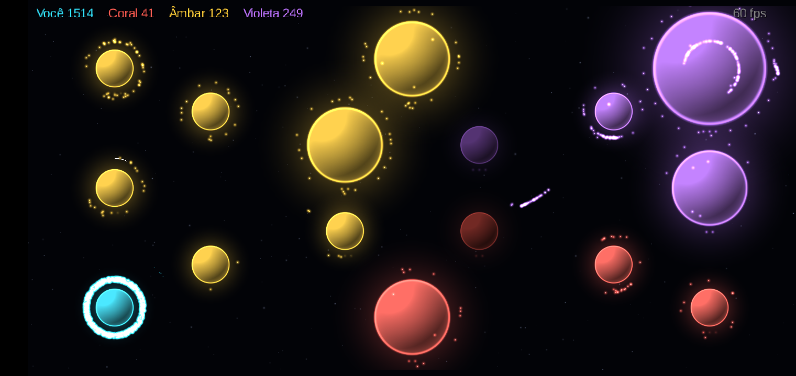

# 4. Testes e desempenho

## Testes automatizados

`./gradlew :sim:test :ai:test`: 17 testes, todos verdes (execução de 27/10/2026).

| ID | Teste | O que garante |
|---|---|---|
| T-01 | Produção | Planeta nível 2 isolado gera 40 unidades em 1.280 ticks |
| T-02 | Custo e saúde | Tabelas de evolução para os níveis 0 a 5 |
| T-03 | Choque | 5 contra 3 deixa 1 unidade de power 2 |
| T-04 | Ataque | 130 contra um planeta de saúde 100: destruído, 30 sobrevivem, dono mantido |
| T-05 | Cabo de guerra | Um neutro muda de dono quando o adversário investe mais |
| T-06 | Evolução | Nível 1 → 2 → 3 com 100 unidades cada |
| T-07 | Recusa | Planeta no nível máximo e com saúde cheia não consome a unidade |
| T-08 | Reconstrução | O dono reconstrói o próprio planeta destruído |
| T-09 | Eliminação | Condições de derrota e vitória |
| T-10 | Determinismo | Duas execuções e um replay pelo log de comandos dão o mesmo hash a cada 60 ticks |
| T-12 | Desvio | Unidades contornam planetas ativos e atravessam os sem dono |
| T-13 | Nuvem | Enxame parado forma uma nuvem viva em volta do ponto, sem derivar |
| IA | Expansão | Os bots capturam neutros no primeiro minuto |
| IA | Vitória | Os bots eliminam um jogador parado em menos de 15 min |
| IA | Determinismo | Partida bot × bot é reproduzível |
| Mapas | Geometria | Todos os 13 mapas: ids únicos, planetas dentro da área e espaçados, bases equidistantes do centro |
| Mapas | Jogabilidade | Em cada mapa, uma partida curta só com bots captura neutros |

O T-11 (desempenho) roda como sonda separada, no desktop e no aparelho.

## Determinismo entre plataformas

A sonda roda a mesma partida roteirizada (seed 12345) e imprime o hash final e dos checkpoints:

```bash
./gradlew :desktop:probe
adb shell am start -n dev.orbita.spike/dev.orbita.android.ProbeActivity --el seed 12345
adb logcat -s ORBITA_PROBE
```

Resultado: **hash idêntico** na JVM desktop (x86-64) e no Android 11 (ARMv7, Galaxy A10). Sempre que a
simulação muda, a sonda roda de novo nas duas plataformas.

## Desempenho

**Aparelho de referência:** Samsung Galaxy A10, Exynos 7884, Android 11, APK em ARMv7 32 bits.

| Medição | Desktop (Ryzen 7 7730U) | Galaxy A10 |
|---|---|---|
| Simulação, pico de 2.016 unidades em batalha | 0,02 ms/tick (pior 0,09) | 1,93 ms/tick (pior 2,4) |
| Spike: 2.000 partículas, busca escalonada | 0,11 ms/tick | ~3,2 ms/tick, 60 fps |
| Partida real com ~1.600 unidades | — | 60–61 fps |
| Estresse: 6.000 unidades + batalha de 1.500 | — | 60 fps |
| Estresse: 12.000 unidades | — | mínimo de 14 fps no pico, volta a 60; sem crash |
| GC durante a partida | — | zero no spike |
| Vazamento de memória (20 min de partida, `leakCheck`) | 540 KB, estável | — |

O orçamento de um frame a 60 fps é de 16,6 ms. No A10, a simulação usa ~2 ms e a renderização de 2 a 4 ms
de CPU, com tudo num único atlas de texturas.

**Perfil por fase no A10** (ms/tick): comandos e produção 0,00 · grade 0,08 · **busca de inimigos 1,76** ·
movimento 0,05 · choques 0,03. A busca é o alvo de qualquer otimização futura.



*Teste de estresse no A10 (`--ei stress N`), com mais de 1.500 unidades do jogador.*

## Robustez

- **Gravador de crash:** pilha e estado do heap salvos em `files/crashes/` e no logcat (`ORBITA_CRASH`), para
  todas as threads.
- **No máximo 4 ticks por frame:** evita a "espiral da morte" do passo fixo.
- **HUD sem alocação por frame** (`StringBuilder` reaproveitado).
