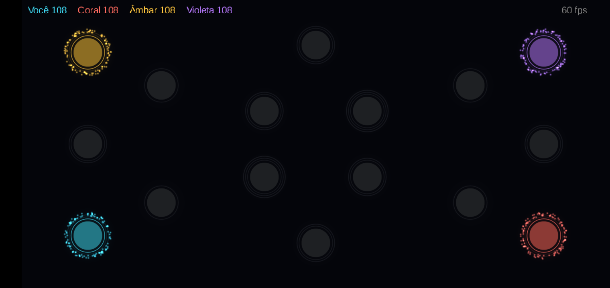
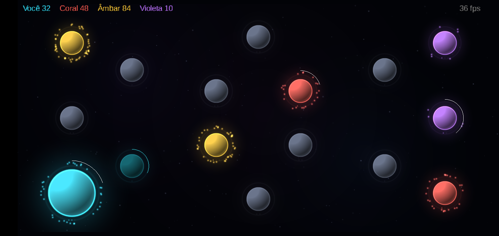
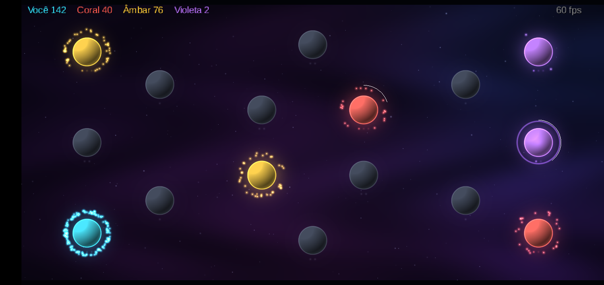
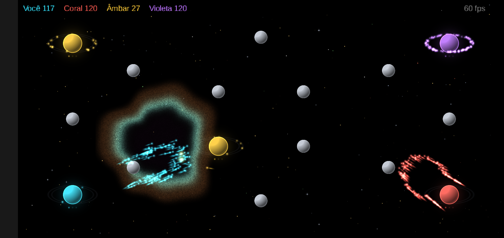
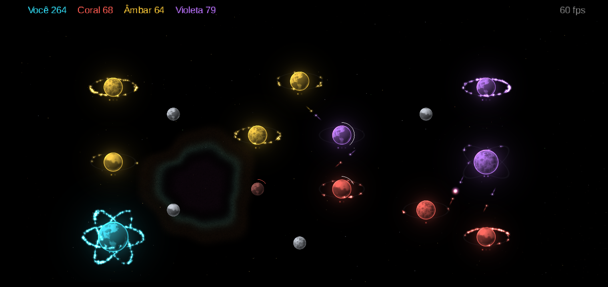
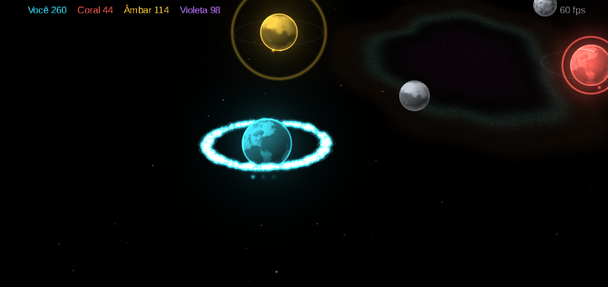
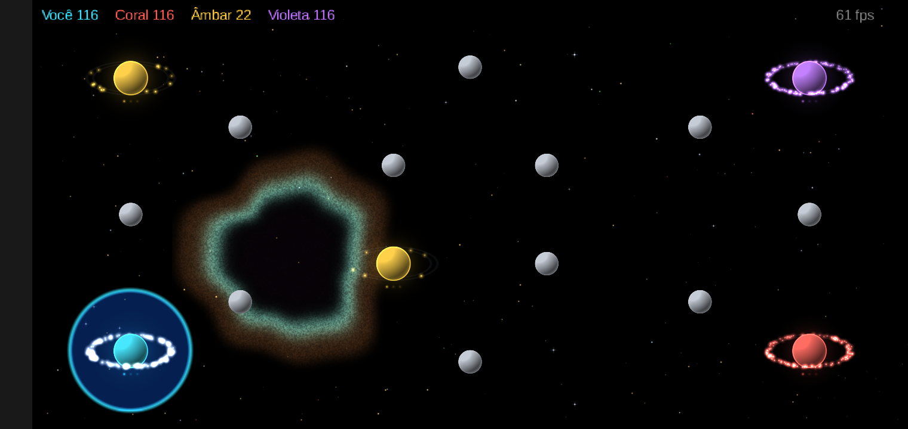
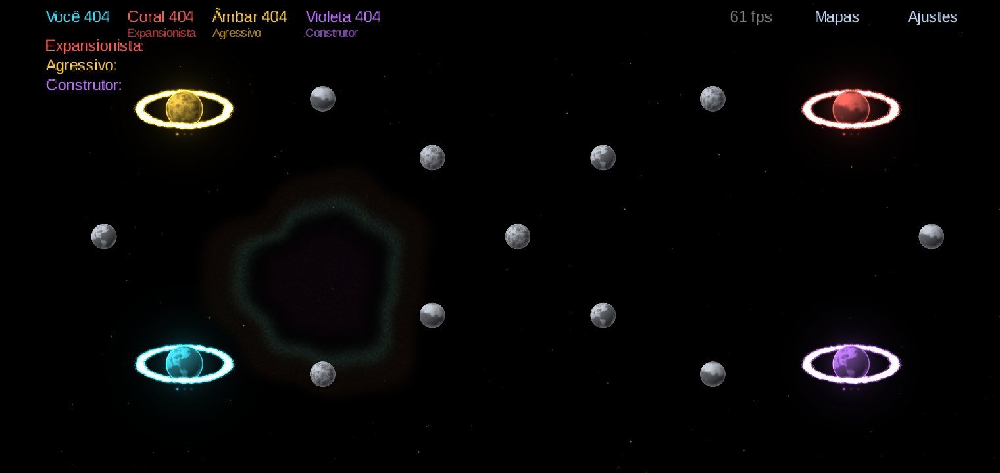
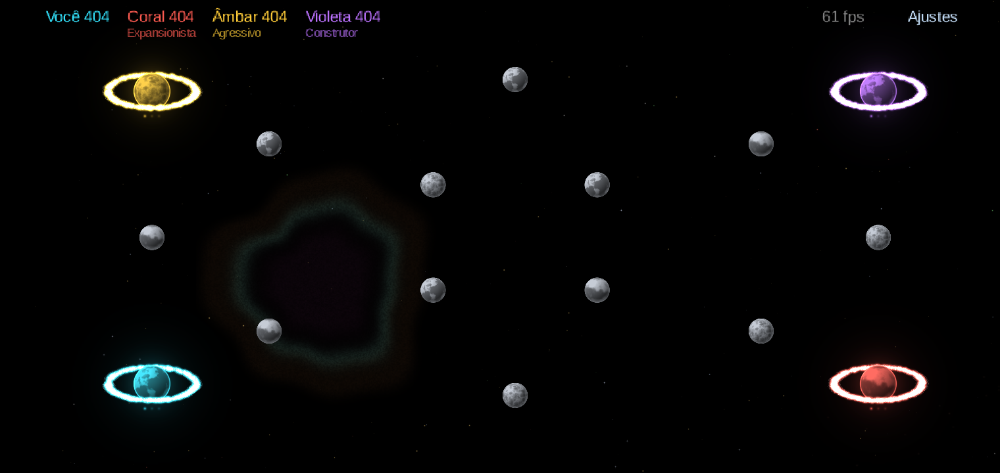

# 5. Evolução visual

Todas as capturas foram tiradas no Galaxy A10 via ADB, ao longo do mesmo dia. Nenhuma imagem do jogo usa
arquivo de arte: tudo é desenhado com texturas geradas em código.

## 1. Primeira partida jogável

Planetas como discos, unidades como pontos e o HUD com o power de cada facção. Já com laço de seleção, envio de
ordens e captura. O objetivo era só provar as regras na tela.

## 2. Planetas com volume

Esferas sombreadas na cor do dono, coroa pulsante e pontos de nível. Foi aqui que o fps caiu para 15–36 e
descobrimos que a causa era a troca de textura no `SpriteBatch`, não a GPU. Um atlas único resolveu.

## 3. Nebulosa e coroas suaves

Brilhos gaussianos, unidades maiores e uma nebulosa pré-renderizada numa textura pequena (um quad por frame),
com temas por fase.

## 4. Enxames vivos

Primeira rodada de ajustes de jogabilidade, a partir de quem estava jogando:

- unidades em trânsito viram **cometas** com rastro;
- enxames parados formam uma **nuvem viva**, que "ferve" sem sair do lugar;
- unidades **contornam planetas** em vez de atravessá-los;
- mortes viram **clarões** brancos que se somam numa batalha grande;
- fundo preto, estrelas nítidas e uma nebulosa localizada.

## 5. Planetas texturizados e órbitas por nível

- 3 superfícies procedurais (oceano, mármore e lava) com ruído 3D, tingidas pela cor do dono;
- **o número de planos de órbita é o nível do planeta**: um planeta evoluído vira um giroscópio de anéis;
- unidades como "contas de vidro": estrela de 4 pontas, halo e anel fino;
- um pulso no planeta a cada leva de produção.

## 6. Câmera em perspectiva

Ao aproximar, a câmera inclina até 42° e o mapa passa a ser visto em perspectiva. Planetas e unidades continuam
redondos, as órbitas viram elipses e o toque continua exato porque usa o raio da câmera.

## Hoje

| Seleção | Mapas | Perfis dos bots |
|---|---|---|
|  |  |  |

## Ajustes de jogabilidade (AJ-01…AJ-23)

| ID | Ajuste |
|---|---|
| AJ-01 | Pan além das bordas com resistência e mola de retorno |
| AJ-02, AJ-11 | Enxame parado vira nuvem viva (ruído, mola e amortecimento, determinístico) |
| AJ-03, AJ-04 | Desvio de planetas ativos; planetas sem dono não bloqueiam |
| AJ-05 | Depois de destruir um planeta, o enxame vai até o centro dele |
| AJ-06 | Seleção com disco translúcido e unidades selecionadas em branco |
| AJ-07 | Órbitas em elipse, com a metade de trás atrás do planeta |
| AJ-08 | Clarão branco quente por unidade abatida |
| AJ-09 | Velocidade individual ±12%, para o enxame se alongar no caminho |
| AJ-10 | Zoom de 0,45× a 2,2× |
| AJ-12 | Unidades em trânsito como cometas |
| AJ-13…15 | Fundo preto, 1.400 estrelas nítidas e nebulosa localizada |
| AJ-16 | Neutros cinza-claros, menores e sem coroa |
| AJ-17 | Superfícies procedurais dos planetas |
| AJ-18 | Unidade "conta de vidro" |
| AJ-19 | Planos de órbita = nível do planeta |
| AJ-20 | Aura grande e tênue na cor do dono |
| AJ-21 | Pulso a cada leva de produção |
| AJ-22 | Câmera 3D que inclina com o zoom |
| AJ-23 | Atração entre unidades limitada (partidas decididas: 16% → 33%) |
